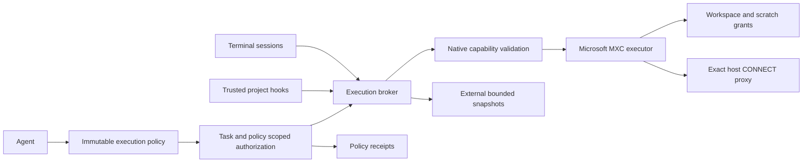

# Windows command containment

PANINI Sandbox is built directly from the Microsoft MXC 1.0.0 source under
`src/panini_cli/panini-sandbox`. Its native executor and C ABI DLL power the CLI's
execution broker, commands, terminals and project hooks. There is no npm runtime
download or Node wrapper. This integration has not had an independent security audit.

## Start and inspect

```powershell
./scripts/build-sandbox.ps1
panini-cli sandbox install
panini-cli sandbox status
panini-cli exec "Run the project tests" --sandbox mxc
panini-cli exec "Inspect the project" --sandbox mxc --approval-mode read-only
panini-cli exec "Install dependencies and run tests" --sandbox mxc --network-host registry.npmjs.org
panini-cli exec "Refactor and verify" --sandbox mxc --recoverable
panini-cli sandbox restore SNAPSHOT_ID -C C:\path\to\project
```

Building requires public Rust 1.93.0, Visual Studio C++ build tools and a Windows SDK.
The build uses the checked-in Cargo lockfile and preserves upstream CFG, ASLR, CET
and static CRT hardening. It builds only `mxc-sdk`, `mxc_ffi` and `wxc`, without optional
VM backends. Shared engine code and native test fixtures remain in the source tree.
Unused release pipelines, separate language SDKs, samples and tools were moved to
`build/unused-panini-sandbox` after automatic approval review blocked deletion.

The standalone `dist/panini-cli.exe` installs its verified bundled executor and DLL
automatically on first sandbox use. Source/wheel users can run `sandbox install`
explicitly. Installation places the engine outside the writable workspace
at `~/.panini/runtime/panini-sandbox/1.0.0/panini-source-1-<build hash>`.
The native PE version embeds the source identity; `build.json` records every source
file and runtime SHA-256 digest. Execution checks the installed files against the
manifest bundled with this CLI. Builds have distinct installation directories;
installing the same build again is harmless. This shared home location also avoids
Windows Store Python's AppData virtualization. Commands never build, download or
fall back to a different executor automatically.

`scripts/build-windows.ps1` builds the native source first and bundles these same
artifacts into the single-file Windows CLI. No adjacent Python/DLL/native runtime
folder is needed in `dist`; temporary extraction and the protected user runtime are
managed by the executable. Wheels include built runtime artifacts through
package data; run the native build before making a Windows wheel.

`sandbox status` validates the requested configuration and reports the actual
containment tier. It is a capability probe, not proof that every possible escape
has been tested. It needs neither an API key nor a cloud request. This adapter
requires native BaseContainer, native path denial and metadata-only path enumeration;
hosts that need AppContainer host ACL mutation are refused. No failure retries a
command with host access. The default Windows backend is `mxc`; `native`, `docker`
and `codex` remain explicit compatibility adapters with different guarantees.

## Architecture



`ExecutionBroker` owns effective policy and backend preparation. Commands, project
hooks and MXC terminal launches use that broker. A frozen policy carries workspace,
read-only mode, toolchain read roots, network hosts and resource limits. Its identity
changes when these permissions or the native runtime build change. Approvals are keyed by command, task, working
directory, execution scope and that policy identity. An offline workspace approval
cannot authorize host execution or replay after networking or filesystem mode changes.

Filesystem link checks accept Cargo-style hard links only when every link is
inside the same writable workspace. Links to shared caches, external files,
secrets or protected metadata are refused. Use package-manager copy modes for
global caches; no broad host escalation is needed for internal build links.

Native probing uses the SDK C ABI in process; the verified DLL is reused. Workloads
run through `wxc-exec.exe` with configuration in a separate, non-granted temporary
directory. Avoiding command-line policy blobs also avoids Windows command-length
limits. Each invocation gets fresh scratch storage and a private environment.

## Effective permissions

| Area | MXC policy |
| --- | --- |
| Project files | Workspace read/write for coding; read-only for exploration. |
| Project control metadata | `.git` and `.panini` are read-only to arbitrary commands. |
| Secret files | Existing recognized secret paths, including nested ones, are denied at launch using native filesystem exclusions. |
| Toolchains | Explicit install roots read-only; required ancestors receive metadata-only access without masking those read grants. |
| Environment | Allowlisted Windows essentials, scratch home and temp, safe tool settings; no inherited API tokens, database URLs or credential-agent sockets. |
| Network | Offline by default; approved exact public DNS hosts through a CONNECT proxy on port 443. |
| Host services | Direct connections to PANINI, Ollama and other host loopback ports denied, including in tested proxy mode. |
| UI | Clipboard and input injection denied. PowerShell requires Win32k initialization, so blanket Win32k disable is not used. |
| Process tree | Windows Job: kill on close, 64 processes, 2 GiB memory, 50% CPU ceiling. Commands also have timeout and 4 MiB emitted-output limits. |
| Terminals | Up to four pipe sessions, retained output bounded to 200,000 characters, default lifetime one hour, process tree killed at stop/shutdown. |

The application does not put provider credentials into arbitrary execution. MCP
servers receive a minimal inherited environment plus the user's explicit server
environment; they remain trusted host programs. User-owned hooks are also trusted
host programs. Repository hooks require trust of their configuration and run inside
the task boundary. Changing the configuration invalidates trust; changing a referenced
script does not grant host access.

Fixed-purpose Git bookkeeping remains privileged so it can maintain the private
index and PANINI refs. It strips inherited credentials, overrides repository-selected
clean/smudge/process filters and signing, and disables hooks, fsmonitor, external diff
and textconv. It preserves normal Git line-ending settings. This is a deliberately
limited trusted adapter; arbitrary model-selected Git commands still use the broker.

## Network exceptions

The agent can call `request_network_access` with exact hosts and a reason. Approval
adds only those destinations for the session; the filesystem boundary and backend
remain the same. CLI `--network-host` and user `network_hosts` configuration are explicit
grants. PyPI typically needs both `pypi.org` and `files.pythonhosted.org`; GitHub downloads
may need additional hosts for redirects. Redirect destinations must be granted too.

The host proxy validates every DNS answer as public and connects to the validated
socket address. Private, local, reserved and mixed DNS results are rejected. MXC
enforces proxy-only egress; deleting proxy variables does not enable direct access.
The proxy permits CONNECT to exact hosts on 443, holds no provider credentials,
and bounds handlers and tunnel lifetime. It does not inspect encrypted payloads:
a permitted destination can receive project data, and CONNECT does not prove the
payload is HTTPS. Allowed registries may host malicious packages.

The proxy currently runs as an unpackaged host process. Microsoft documents this
as its lowest-assurance proxy deployment: WFP scopes the endpoint but does not verify
the listener's package identity. A packaged AppContainer proxy is the next hardening
step. SSH transport and credentialed Git push are not supplied by this implementation.
Use an explicit trusted host operation for those actions; registry access never implies
credential access.

## Terminals and built web previews

`terminal_start`, `terminal_send`, `terminal_read` and `terminal_stop` support sandboxed
REPLs, watch builds and server processes. A terminal retains its launch authorization;
switching the application to read-only does not relabel an existing writable process
as read-only. Pipe terminals are the default. `terminal_start` with `tty=true`
uses ConPTY on Windows (cmd syntax) or a Unix PTY; `terminal_resize` changes its
dimensions without changing the session's sandbox or network grants.

Build a web app inside MXC, then preview its compiled output:

```powershell
.\Start-Panini.cmd --sandbox mxc --network-host registry.npmjs.org exec "Install the project's npm dependencies" -C D:\projects\my-app
.\Start-Panini.cmd --sandbox mxc exec "Build the app and run its tests" -C D:\projects\my-app
.\Start-Panini.cmd preview dist -C D:\projects\my-app
```

The last command needs no model API key. Open the printed local URL; Ctrl+C stops it.
`--timeout` sets its lifetime (default one hour, maximum one day). `--json` emits the
URL and effective policy. In interactive agent sessions, `--local-preview` enables
`preview_start`, `preview_list` and `preview_stop`; previews close with the agent.
A one-shot `exec` closes its agent immediately, so use the standalone preview command
to retain a browser preview after a build.

Preview is a fixed-purpose, read-only host asset service, not a host shell command.
It serves one built subdirectory containing `index.html`, supports SPA routes, and
requires a random launch token that becomes an HttpOnly, SameSite=Strict cookie.
The listener binds only to `127.0.0.1`; Host, Origin and Fetch Metadata checks reject
cross-origin requests. Every asset request checks the filesystem boundary, opened
file handle, secret patterns, hidden paths, symlinks, junctions and hardlinks.
Limits are two previews, sixteen requests per preview and 32 MiB per asset.

Browser CSP permits local assets and denies external connections, frames, form posts
and workers/service workers. This mode supports compiled client applications.
Version 2.1 also supports Node HTTP entries using `preview --dev-entry FILE` or
the preview tool's `entry` parameter. A preload adapter provides virtual HTTP
sockets over bounded stdio frames: SSR and WebSocket HMR execute inside offline
MXC, without host TCP forwarding or granting host-loopback access. The public
gateway authenticates the browser, enforces CSP and filters sensitive paths and
credentials. One virtual HTTP port is supported; non-Node servers and separate
HMR ports are not supported by this adapter. Request bodies are limited to 32 KiB,
responses/streams to 8 MiB, and connections to sixteen. App cookies are stripped;
apps that depend on browser cookies or external APIs need a separate capability.
Preview does not widen MXC host-loopback or network permissions: sandboxed project
code still cannot reach PANINI or unrelated host services. Build output can contain
arbitrarily named or embedded secrets; do not compile real credentials into it.

Run the reproducible packaged-CLI UAT without Python or an API key:

```powershell
.\dist\panini-cli.exe sandbox uat
.\dist\panini-cli.exe sandbox uat --web --serve --open
```

It installs Vite with registry-only HTTPS access, builds and tests offline, checks
authenticated compiled assets and secret/traversal denials, verifies native receipts
contain no host escalation, and writes `build/web-sandbox-verification.json`.
Each run creates a separate demo project under `build/web-sandbox-uat`. `--output`
selects a different report/demo folder. Web UAT needs the project's Node.js/npm
toolchain. The developer Python wrappers call these same bundled UAT implementations.

## File recovery

`--recoverable` captures regular project files before commands and terminal sessions,
including untracked and ignored files. It excludes `.git`, `.panini`, recognized secrets
and linked files. Capture is outside the workspace, bounded to 50,000 files/512 MiB
per snapshot and 20 snapshots/2 GiB total. A capture that exceeds a limit prevents
execution. The completed command or stopped terminal reports its snapshot ID.

Restoration compares current content against the recorded post-execution content.
Later user edits are preserved and reported as conflicts; unchanged agent-created files
are removed and deleted originals restored. This is file recovery, not transactional
rollback: it does not restore secrets, metadata, permissions, registry state, external
side effects or directories as objects. Concurrent writers can make recovery ambiguous.
After an abrupt application crash, a snapshot without a completion record requires
manual inspection and automatic restoration is refused.

## Remaining boundaries and validation

Secrets with arbitrary names, embedded in source, or retained in accessible Git history
are ordinary readable project data.
Existing recognized paths are collected at launch; concurrent secret creation is not
a dynamic deny policy. Keep actual credentials outside the workspace and toolchain
read grants. Workspace link/hardlink checks run before launch; this is not a complete
defense against concurrent hostile filesystem mutation. Use a protected installed CLI
outside the writable project when processing an untrusted repository, rather than
running mutable agent source from that repository.

Filesystem containment does not impose a disk quota on files written directly by
children. CPU/memory/process/output limits reduce runaway damage, but volume quotas or
a VM are needed to contain disk exhaustion. Native process isolation shares the host
kernel and does not replace a VM for actively hostile binaries or kernel exploits.

The regression suite includes native Windows checks for Python and Node execution,
workspace write, outside write denial, secret denial, read-only mode, protected Git
metadata, environment stripping, output limits, timeout, terminal input/cleanup,
and denial of a synthetic host control service. An opt-in live registry test installs
an npm package in MXC and executes it offline:

```powershell
py -3.12 -m pytest tests/test_execution_policy.py -q
py -3.12 scripts/smoke-sandbox.py
$env:PANINI_TEST_NETWORK = '1'
py -3.12 -m pytest tests/test_execution_policy.py -q
```

The packaged smoke check uses a scripted model and synthetic secrets, verifies
workspace writes and outside/secret denial, checks the receipt's source-build
identity, and restores a deleted file. It writes `build/sandbox-verification.json`.
`panini-cli sandbox uat --features --web` additionally checks durable RPC policy,
resume, steering, image plumbing, skills, a background worker, real ConPTY size
changes, SSR, Vite HTTP, a WebSocket handshake and a hot update. The feature and
web reports are written alongside the boundary report. OAuth JSON/SSE and managed
worktree behavior have separate automated integration tests.

These checks establish specific tested behaviors on a supporting Windows host.
Claims of superiority over another CLI need comparative task completion, interruption,
latency, recovery and adversarial escape benchmarks, plus external security review.

References: [Microsoft MXC](https://github.com/microsoft/mxc),
[network enforcement](https://github.com/microsoft/mxc/blob/main/docs/backends/process-container/networking.md),
[request schema](https://github.com/microsoft/mxc/blob/main/docs/schema.md).
